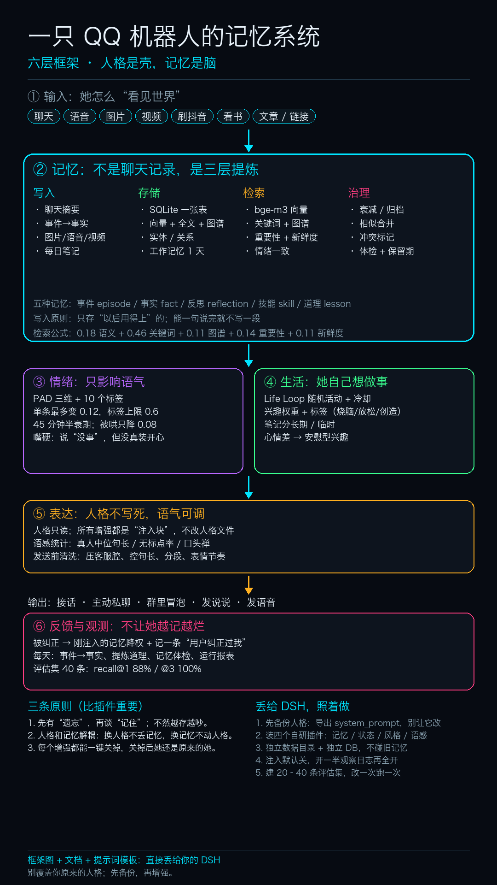

# 个人 AI 记忆与生活架构

> 给聊天机器人一套能长期跑的记忆、情绪、表达和生活层。
> **不是新算法，是一套可落地的工程整合。**



## 它解决什么

普通机器人聊完就忘。这里做了五件事：

1. **记忆**：事件 / 事实 / 反思 / 技能 / 道理，五种分开存
2. **检索**：向量 + 关键词 + 实体图谱 + 重要性 + 新鲜度，五路混合
3. **遗忘**：衰减、归档、相似合并、冲突检测、体检
4. **情绪**：PAD 三维 + 标签，有上限、有半衰期、不主导判断
5. **生活**：你没找她时，她也会看书、刷视频、午睡，笔记回流记忆

## 不覆盖你的人格

这是硬约束：

- 人格文件**只读**，所有增强都是往 system_prompt 追加“注入块”
- 每个注入块带 marker，重复注入先删旧块
- 每个模块一个开关，默认关，关掉后她还是原来的她
- 生活层只写自己的目录，不碰人格和聊天数据

## 仓库结构

```
plugins/                     四个 AstrBot 插件
  astrbot_plugin_memory_brain        记忆库
  astrbot_plugin_persona_state       情绪 / 好感 / 识海
  astrbot_plugin_human_style_guard   发送前清洗
  astrbot_plugin_self_style          自我档案 / 语气样例
life/                        生活层（独立进程，可选）
docs/                        框架图、设计说明
eval/                        检索评估集（示例）
tests/                       单元测试（不需要 AstrBot）
tools/                       评估脚本
```

## 安装

### 1. 记忆与情绪（AstrBot 插件）

把 `plugins/` 下四个目录放进 `AstrBot/data/plugins/`，重启。

依赖：

```bash
pip install faster-whisper pilk   # 可选：语音转写
```

embedding 自己配：默认读插件配置里的 `embedding_provider_id`，没配就退化为关键词检索。

### 2. 生活层（可选）

```bash
cd life
python life_loop.py --once      # 干跑
python life_loop.py --send      # 常驻
```

不配任何环境变量也能跑，只是不刷手机、不发消息。

## 建议的开启顺序

1. 只开写入，不开注入，跑一天看摘要质量
2. 私聊开注入，再开群聊
3. 最后接情绪层
4. 建 20–40 条自己的评估集，改一次跑一次

## 能到什么程度（参考值，不是承诺）

| 指标 | 参考 |
|---|---|
单轮上下文 | 1.5–1.8 万 token，其中记忆注入约 300 token（≈2%） |
记忆规模 | 每天 60 条 → 一年 2.2 万条；十年 22 万条，约 2.4GB |
实际占用 | 开着 180 天清理时，稳定在 100–200MB |
检索延迟 | 当前规模 p50 约 18ms；10 万条以上建议加 ANN 索引 |
成本 | DeepSeek 约 2–4 分/轮；一天 100 轮约 2–4 元；本地模型 0 |
生活层 | 一天 20–40 轮动作，笔记 3 条以上 |

结论：**存储不是瓶颈，保留策略才是。** 十年不用换硬件，想记更久就关掉 180 天清理。

## 评估

仓库带了一份示例评估集和脚本：

```bash
python tools/eval_memory.py --brain path/to/brain.db --queries eval/queries.example.jsonl
```

我们在 40 条中文真实问法上的结果（仅供参考，和模型、数据强相关）：

```
recall@1 88% · recall@3 100% · MRR 0.938 · p50 18ms
```

## 测试

```bash
python -m unittest discover -s tests
```

只依赖标准库 + numpy，不需要 AstrBot。

## 兼容性

- AstrBot 4.29.x
- Python 3.12
- SQLite（内置）
- 可选：Ollama / bge-m3、faster-whisper、ffmpeg、adb

## License

AGPL-3.0-or-later。因为 AstrBot 本身是 AGPL-3.0，插件作为衍生作品沿用同一协议。

## 说明

- 仓库不含任何个人数据、聊天记录、人格文本
- 示例里的“角色/用户”都是占位符
- 情绪和记忆会让人更像人，但也请别用它替代真实关系
